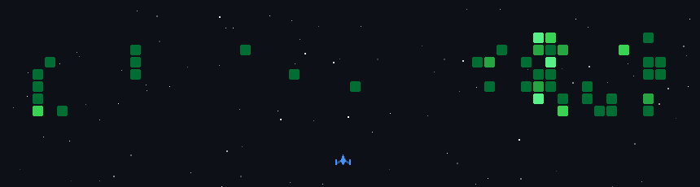

<div align="center">

<p>
  <a href="https://github.com/harshita-8605">
    
  </a>
</p>

<p>
  
</p>

<p>
  <a href="https://github.com/harshita-8605"></a>
  <a href="https://www.linkedin.com/in/harshita-narula-8a9980310"></a>
</p>

</div>

## `~/about`

```python
harshita = {
    "role": "AI/ML & Full-Stack Developer",
    "building": [
        "intelligent applications",
        "agentic workflows",
        "creative developer tools",
    ],
    "interests": [
        "machine learning",
        "software engineering",
        "open source",
        "continuous learning",
    ],
    "toolkit": ["Python", "TypeScript", "C++", "Git"],
}
```

## `~/stack`

<p align="center">
  
</p>

## `~/projects`

<table>
<tr>
<td valign="top" width="50%">

### [Nodebase](https://github.com/harshita-8605/Nodebase)

Modern full-stack SaaS foundations with Next.js, PostgreSQL, Drizzle, Better Auth, Trigger.dev, and Sentry.

`TypeScript` `Next.js` `PostgreSQL`

</td>
<td valign="top" width="50%">

### [Nyaya-bot](https://github.com/harshita-8605/Nyaya-bot)

An AI application with a Python backend and tool-driven workflows for practical, structured language-model systems.

`Python` `AI/ML` `Docker`

</td>
</tr>
<tr>
<td valign="top" width="50%">

### [Anime Portal](https://github.com/harshita-8605/Anime-Portal)

A computer-vision experiment combining hand tracking, MediaPipe, OpenCV, geometry, masking, and compositing.

`Python` `OpenCV` `MediaPipe`

</td>
<td valign="top" width="50%">

### [LeetCode Solutions](https://github.com/harshita-8605/Leetcode-Solutions)

A growing collection of solutions covering arrays, graphs, dynamic programming, backtracking, strings, and more.

`C++` `DSA` `Problem solving`

</td>
</tr>
</table>

## `~/contribution`

<p align="center">
  
</p>

<br />

<div align="center">
  <i>Curious mind. Consistent builder. Always learning.</i>
</div>
