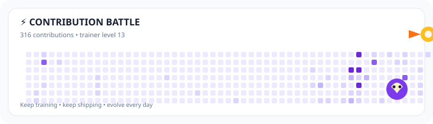

<div align="center">

<a href="https://github.com/harshita-8605">
  
</a>

<p>
  <a href="https://github.com/harshita-8605"></a>
  <a href="https://www.linkedin.com/in/harshita-narula-8a9980310"></a>
  
</p>

</div>

<table>
<tr>
<td valign="top" width="48%">

## `~/whoami`

```python
harshita = {
    "role": "AI/ML & Full-Stack Developer",
    "building": [
        "intelligent applications",
        "agentic workflows",
        "creative developer tools",
    ],
    "interests": [
        "machine learning",
        "computer vision",
        "web products",
        "problem solving",
    ],
    "toolkit": ["Python", "TypeScript", "C++", "Docker"],
}
```

I like turning ambitious ideas into products that are understandable, useful, and fun to use.

</td>
<td valign="top" width="52%">

## `~/stack`

**Languages**


**Frameworks & tools**


**Currently exploring**

`AI agents` · `computer vision` · `LLM applications` · `system design`

</td>
</tr>
</table>

## `~/projects`

<table>
<tr>
<td valign="top" width="50%">

### [Nodebase](https://github.com/harshita-8605/Nodebase)

A full-stack product built with Next.js, PostgreSQL, Drizzle, Better Auth, Trigger.dev, and Sentry. A focused project for exploring modern SaaS foundations, authentication, billing, and background workflows.

`TypeScript` `Next.js` `PostgreSQL`

</td>
<td valign="top" width="50%">

### [Nyaya-bot](https://github.com/harshita-8605/Nyaya-bot)

An AI application built around a Python backend and tool-driven workflows. It reflects my interest in making language-model systems practical, structured, and useful.

`Python` `AI/ML` `Docker`

</td>
</tr>
<tr>
<td valign="top" width="50%">

### [Anime Portal](https://github.com/harshita-8605/Anime-Portal)

A real-time computer-vision experiment that uses hand tracking to create a portal into an anime-styled webcam feed. The pipeline combines MediaPipe, OpenCV, geometry, masking, and compositing.

`Python` `OpenCV` `MediaPipe`

</td>
<td valign="top" width="50%">

### [LeetCode Solutions](https://github.com/harshita-8605/Leetcode-Solutions)

A growing collection of interview problems covering arrays, graphs, dynamic programming, backtracking, strings, and more — written while building consistency in problem solving.

`C++` `DSA` `Problem solving`

</td>
</tr>
</table>

## `~/activity`

<div align="center">
  
  
</div>

## `~/contribution-battle`

<p align="center">
  <i>Every contribution is another move. Keep training, keep shipping.</i>
</p>

<picture>
  <source media="(prefers-color-scheme: dark)" srcset="pokemon-battle-dark.svg">
  <source media="(prefers-color-scheme: light)" srcset="pokemon-battle.svg">
  
</picture>

<div align="center">
  <sub>Automatically refreshed every day from my GitHub contribution calendar.</sub>
</div>

<br>

<div align="center">
  <i>Curious mind. Consistent builder. Always learning.</i>
</div>
